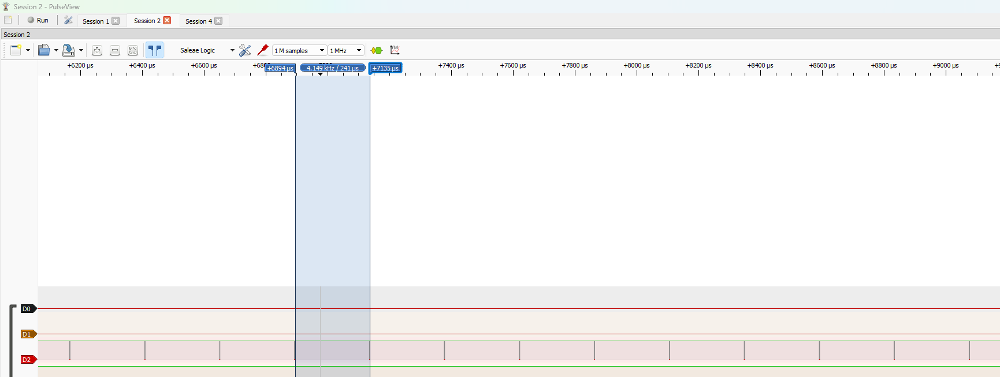
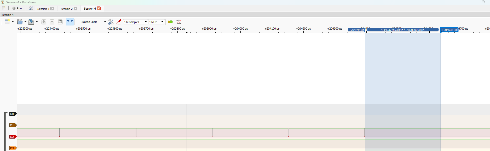
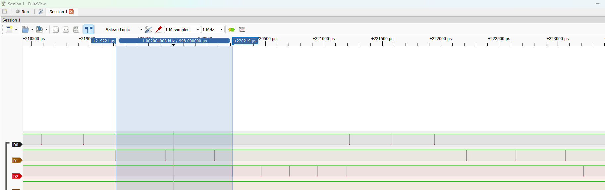
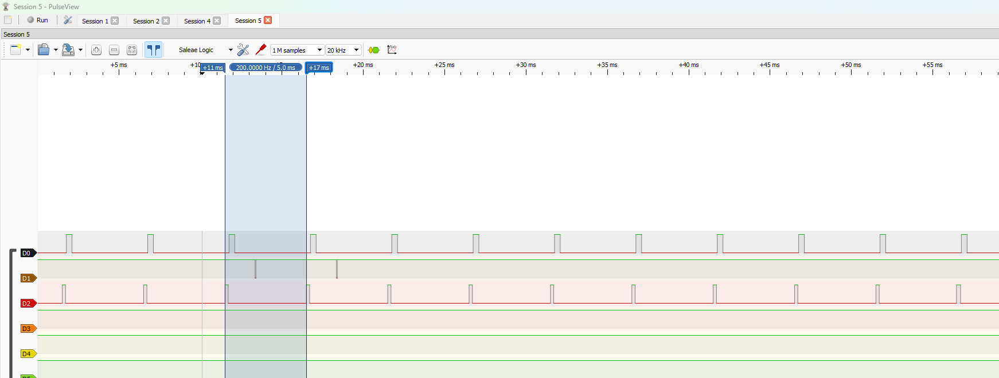

# Report — Week 1 / Ex2

`student_id`: 2510343    Commit của PREDICTION.md: 14/10 -10h20

## 1. CPU share đo được
| Cấu hình | A (%) | B (%) | C (%) | Time slice đo được | Ảnh |
|---|---|---|---|---|---|
| B2: preempt=1, ưu tiên khác nhau | 0 | 0 | 99.6 | — |  |
| B3: preempt=0, ưu tiên khác nhau | 0 | 0 | 99.6 | — |  |
| B4: preempt=1, cùng ưu tiên | 33.301  | 33.307  | 33.28 | 0.998ms |  |
| B5: sau khi sửa starvation | 7 | 88 | 5 | — |  |

Cách tính CPU share từ ảnh PulseView (mô tả ngắn): tổng thời gian task chiếm CPU / tổng thời gian đo. 
- ví dụ B5: tổng thời gian là 5ms, taskA chiếm CPU trong 350us ( đo trên Pusle View) nên nó chiếm 7% CPU
- vd B4: lấy tổng 6ms ( tìm 2 thời gian hoạt động của từng task trước khi bị cướp quyền rồi cộng lại chia 6000)

## 2. Preemption nhìn thấy ở đâu
Trên ảnh **bước 4** (cùng ưu tiên, round-robin), chỉ ra ít nhất **2 thời điểm**
preemption xảy ra. Với mỗi thời điểm: dấu thời gian, task bị cắt, task chiếm CPU,
và vì sao (hết time slice, không phải block).

| t (us) | Task bị preempt | Task chiếm CPU | Lý do |
|---|---|---|---|
| 405829 | C |A | Hết time_slice, ngắt SysTick kích hoạt đổi task|
| 406583 | A |B | Hết time_slice, ngắt SysTick kích hoạt đổi task|

Ở **bước 2** (ưu tiên khác nhau, đều busy-loop không block): giải thích vì sao ảnh
của bạn cho thấy **0 thời điểm preemption**, dù chạy bao lâu đi nữa — dựa vào điều
kiện preemption của FreeRTOS, không phải "vì ảnh chụp chưa đủ dài".
- Do taskC có độ ưu tiên cao nhất nên được Sheduler cấp CPU chạy đầu tiên, không gọi bất kì hàm nào gây BLOCKED như vTaskDelay() nên taskC luôn ở trạng thái running, độc chiếm gần 100% CPU, nên sẽ không có thời điểm nào preemption được ghi nhận.

## 3. Time slice
Time slice đo được ở bước 4: 0.998 ms. `configTICK_RATE_HZ` = 1000.
Sai số: 0.2%. Giải thích sai số: lệch 2us là do thời gian tiêu tốn của hàm `xTaskIncrementTick()`, ngắt `PendSV` thực hiện chuyển context switch, thêm sai số khi lấy mẫu trên logic analyzer

## 4. DWT wrap-around
Tại sao so sánh `DWT->CYCCNT > target` bị sai sau ~59 giây, và cách viết đúng

:
`target = DWT->CYCCNT + cycles` , `2^32/72000000 ~~ 59.65s`, nghĩa là ở 59s, sắp hoàn thành 1 chu kỳ, `DWT->CYCCNT = 4294967295` cộng thêm cycles nữa thì
sẽ tràn về số nhỏ, `DWT->CYCCNT > target` luôn sai, nên hàm thoát ra ngày mà không chờ đủ thời gian. Cách viết đúng là: `(DWT->CYCCNT - start) < cycles` do cơ chế
số học modulo `2^32`, máy tính chỉ lưu số nguyên không dấu, ngay cả khi CYCCNT tràn về 0 thì hiệu `CYCCNT - start` vẫn biễu diễn đúng số chu kỳ qua.
## 5. Sửa starvation
Cách tôi chọn: thêm vTaskDelay(pdMS_TO_TICKS(5))` vào taskC và taskA ;
Vì sao nó hoạt động (dựa vào trạng thái task trong scheduler):
- Khi taskC( có độ ưu tiên cao nhất) hoàn thành lệnh `vTaskDelay()` chuyển sang `BLOCKED`, lúc này taskA ( ưu tiên 3) từ trạng thái `READY` chuyển sang `RUNNING`. Sau khi chạy xong, taskA cũng tương tự chuyển sang  `BLOCKED` nhường cho taskB chạy. TaskB chạy đến khi taskC thức dậy và cướp quyền của taskB.
Đánh đổi: 
- TaskC không còn chiếm 100% CPU để chạy liên tục mà bắt buộc phải có thời gian nghỉ để nhường CPU cho các task khác.
- Trong thời gian task `BLOCKED` nếu có sự kiện phát sinh thì task không thể phản hồi ngay lập tức ( ví dụ nút nhấn khẩn cấp).
- CPU phải tốn thêm chu kỳ để lưu và khôi phục ngữ cảnh.
- Idle tasks bị đói do TaskB không Block

## 6. Lệch so với dự đoán
Mỗi mục lệch + nguyên nhân vật lý.
| Mục | Dự đoán | Thực tế | Nguyên nhân vật lý  |
|---|---|---|---|
| **B2** | 100% | 99.6% (lệch -0.4%) | Mất thời gian xoay vòng của task tầm 1us mỗi vòng ( các ngắt phần cứng SysTick, TIM4 chiếm dụng) |
| **B3** | 100% | 99.6% (lệch -0.4%) |  Mất thời gian xoay vòng của task tầm 1us mỗi vòng ( các ngắt phần cứng SysTick, TIM4 chiếm dụng). |
| **Time_Slice** | 1.000 ms (1000 µs) | 0.998 ms (lệch 2 µs / 0.2%) | Do sai số khi lấy mẫu trên logic analyzer, cùng với thời giann chuyển giữa những context. |
| **B4** | Chia đều 33.33% / 33.33% / 33.33% | A: 33.301% B: 33.307% C: 33.28% |Ngắt SysTick cắt ngang khi hết 1 time_slice gây sai số nhẹ.|
## 7. Câu hỏi đánh đổi
Với **bộ ưu tiên của bạn**, nếu `TASK_C_WORK_US` tăng gấp 3 lần thì bảng CPU share ở
bước 2 thay đổi thế nào? Trả lời bằng số suy ra từ dữ liệu của bạn, rồi **đo lại để
kiểm chứng**. Nếu lệch, giải thích.
- Không có gì thay đổi. `TASK_C_WORK_US` tăng gấp 3 lần (720us), taskC vẫn chiếm quyền CPU do ưu tiên cao nhất
- Task A : 0, TaskB:0, TaskC: 99.7% ( lệch không nhiều)