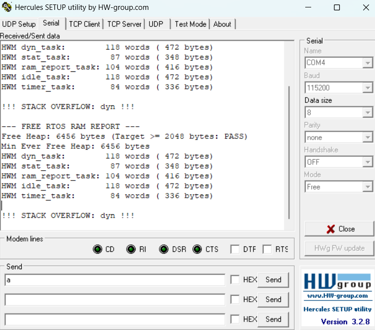

# Report — Week 1 / Ex4

`student_id`: 2510343    Commit của PREDICTION.md: 18/10 - 11h58

## 1. Ngân sách RAM từ `.map`
| Mục | Symbol / section trong `.map` | Bytes |
|---|---|---|
| `.data` | `_sdata` đến `_edata` (section `.data`) | 100 |
| `.bss` (không kể heap) | `_sbss` đến `_ebss` (trừ `.bss.ucHeap`) | 2704 |
| Heap FreeRTOS (`ucHeap`) | `.bss.ucHeap` | 8192 |
| Stack của main (MSP) | `_Min_Stack_Size` (`_sstack` đến `_estack`) | 1024 |
| Còn lại / chưa dùng | Vùng nhớ trống giữa `_ebss` và `_sstack` | 8460 |
| **Tổng** | | **20480** |

`.map` commit tại: `week1/ex4/Week1.map`

## 2. Số lúc chạy (dán nguyên văn log UART)
```
--- FREE RTOS RAM REPORT ---
Free Heap: 6456 bytes (Target >= 2048 bytes: PASS)
Min Ever Free Heap: 6456 bytes
HWM dyn_task:        103 words ( 412 bytes)
HWM stat_task:        72 words ( 288 bytes)
HWM ram_report_task: 104 words ( 416 bytes)
HWM idle_task:       105 words ( 420 bytes)
HWM timer_task:       84 words ( 336 bytes)
```

| Đại lượng | Words | Bytes |
|---|---|---|
| `xPortGetFreeHeapSize()` | 1614 | 6456 |
| `xPortGetMinimumEverFreeHeapSize()` | 1614 | 6456 |
| HWM `dyn_task` | 103 | 412 |
| HWM `stat_task` | 72 | 288 |
| HWM `ram_report_task` | 104 | 416 |
| HWM idle task | 105 | 420 |
| HWM timer task | 84 | 336 |

Heap còn trống >= `TARGET_FREE_HEAP_BYTES` (2048 bytes)? PASS
## 3. Đối chiếu `.map` vs runtime
Heap trong `.map` = 8192 ; `xPortGetFreeHeapSize()` = 6456 ; lệch = 1736 bytes.
Lệch này gồm những gì (liệt kê từng mục kèm số bytes):
| Thành phần | Dung lượng dữ liệu | Block Header (heap_4) | Tổng cộng (bytes) |
|---|---|---|---|
| Heap Sentinel (`pxEnd`) | 0 | 8 | 8 |
| `dyn_task` Stack | 512 | 8 | 520 |
| `dyn_task` TCB | 80 (76 + 4 align) | 8 | 88 |
| `ram_report_task` Stack | 1024 | 8 | 1032 |
| `ram_report_task` TCB | 80 (76 + 4 align) | 8 | 88 |
| `stat_task` | 0 (static, trong `.bss`) | 0 | 0 |
| `idle_task` / `timer_task` | 0 (static, trong `.bss`) | 0 | 0 |
| **Tổng lượng Heap đã dùng** | | | **1736** |

## 4. Dynamic vs static
HWM của `dyn_task` và `stat_task` lệch 31 words dù làm cùng một việc. Vì sao?
`xTaskCreate` và `xTaskCreateStatic` khác nhau ở đâu về **nơi** TCB và stack nằm?
- `dyn_task` tiêu thụ: $128 - 103 = 25 \text{ words}$. `stat_task` tiêu thụ: $96 - 72 = 24 \text{ words}$. Cấp phát khác nhau nhưng cùng làm chung 1 việc
- Sai lệch 1 word là do quá trình căn lề con trỏ stack 8byte khi FreeRTOS khởi tạo khung ngữ cảnh ban đầu.
- `xTaskCreate` và `xTaskCreateStatic` khác nhau ở:
    + `xTaskCreate` : cả 2 đều nằm ở trong vùng heap (ucHeap thuộc section `bss.ucHeap`)
    + `xTaskCreateStatic` : cả 2 nằm trong section `.bss` hoặc `.data` của RAM
## 5. Tràn stack
Log/ảnh chứng minh hook đã chạy:
```text
--- FREE RTOS RAM REPORT ---
Free Heap: 6456 bytes (Target >= 2048 bytes: PASS)
Min Ever Free Heap: 6456 bytes
HWM dyn_task:        118 words ( 472 bytes)
HWM stat_task:        87 words ( 348 bytes)
HWM ram_report_task: 104 words ( 416 bytes)
HWM idle_task:       118 words ( 472 bytes)
HWM timer_task:       84 words ( 336 bytes)

!!! STACK OVERFLOW: dyn !!!
```



Tại sao trong `vApplicationStackOverflowHook` không được gọi hàm UART blocking
(hoặc: nếu bạn vẫn gọi được, giải thích tại sao nó không crash — và tại sao đó là may):
  - Các hàm như `HAL_UART_Transmit` dùng `HAL_GetTick()` để tính timeout. Nhưng trong ngắt `PendSV` (ưu tiên 15), ngắt TIM4 (cũng ưu tiên 15) không thể ngắt để tăng tick, khiến hàm bị kẹt vĩnh viễn nếu có lỗi đường truyền.
  - Nếu hàm in gọi sâu tốn thêm stack, nó có thể lấn sang vùng nhớ quan trọng
  - May vì vùng nhớ tràn chưa đè nát các biến cấu hình UART (`huart1`) hay thanh ghi xung nhịp RCC.
## 6. Stack nhỏ nhất an toàn
| Lần thử | Stack (words) | HWM (words) | Kết quả |
|---|---|---|---|
| 1 (Ban đầu) | 128 | 103 | Chạy bình thường, nhưng lãng phí RAM (dư tới 103 words = 412 B). |
| 2  | 48 | 23 | Chạy được, nhưng biên an toàn 23 words < 32 words (không đạt yêu cầu Rubric). |
| 3 | 64 | 39 | **Đạt chuẩn.** Biên an toàn 39 words $\ge$ 32 words, tiết kiệm được 256 bytes heap. |

Giá trị cuối cùng chọn: **64** words (256 bytes). Biên an toàn: **39** words (156 bytes).

## 7. Lệch so với dự đoán
| Mục | Dự đoán (`PREDICTION.md`) | Thực tế (`Week1.map`) | Chênh lệch (Thực tế − Dự đoán) | Nguyên nhân kỹ thuật / vật lý |
|---|---|---|---|---|
| `.data` | 16 B | 100 B | **+84 B** | Dự đoán chỉ tính biến toàn cục người dùng.  |
| `.bss` (không kể heap) | 2400 B | 2704 B | **+304 B** | Ngoài TCB và stack tĩnh của `stat_task` , thực tế còn có bộ đệm tĩnh của Timer Task và Idle Task  |
| Heap FreeRTOS (`ucHeap`) | 8192 B | 8192 B | **0 B** | Khớp hoàn toàn vì được cấu hình cố định bởi macro `configTOTAL_HEAP_SIZE = 8192`. |
| Stack của main (MSP) | 1024 B | 1024 B | **0 B** | Khớp hoàn toàn vì được cố định bởi `_Min_Stack_Size = 0x400` trong linker script. |
| Còn lại / chưa dùng | 8848 B | 8460 B | **−388 B** | Do các số trên bị lệch. |
| **Tổng** | **20480 B** | **20480 B** | **0 B** | Khớp tuyệt đối với dung lượng 20 KB SRAM của STM32F103C8T6. |

## 8. Câu hỏi đánh đổi
Với `HEAP_SIZE_BYTES` = 8192 của bạn: nếu phải thêm một task nữa có stack 128 words,
**lấy RAM từ đâu**? Dựa vào bảng ngân sách của bạn, đưa ra 2 phương án kèm chi phí
cụ thể (bytes), rồi chọn một và **thực hiện, đo lại để chứng minh**.
- Cấp phát động từ Free Heap còn trống (6456 bytes) nằm trong mảng ucHeap. Cụ thể: stackblock : 512B ( data) + 8B ( header) = 520B, TCB block: 80B (76B + 4B align)+8B (header) = 88B. Tổng = 608bytes
- Cấp phát tĩnh lấy từ 8460 bytes Ram còn lại . Cụ thể: stack tĩnh(128*4=512), TCB tĩnh 84bytes, tổng = 596bytes
- Chọn cấp phát động qua xTaskCreate, heap hiện tại còn trống 6456bytes, cấp thêm 608bytes thì vẫn còn 5848bytes.Ta có thể kiểm chứng lập tức qua API FreeRTOS và logUART mà không làm xáo trộn cấu trúc linker script.
`
--- FREE RTOS RAM REPORT ---
Free Heap: 5848 bytes (Target >= 2048 bytes: PASS)
Min Ever Free Heap: 5848 bytes // sau khi thêm 
HWM dyn_task:        103 words ( 412 bytes)
HWM stat_task:        72 words ( 288 bytes)
HWM ram_report_task: 104 words ( 416 bytes)
HWM idle_task:       105 words ( 420 bytes)
HWM timer_task:       84 words ( 336 bytes)
HWM extra_task:      103 words ( 412 bytes)`