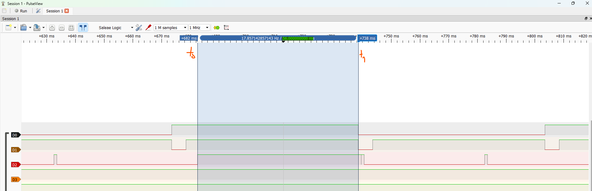

# Report — Week 2 / Ex3

`student_id`: 2510343    Commit của PREDICTION.md:  ba80d0c

## 1. Ảnh đo
Binary semaphore: ``
Mutex: ``

Trên mỗi ảnh, đánh dấu: thời điểm `task_high` sẵn sàng chạy (t0), thời điểm nó
thực sự chạy (t1). Thời gian block = t1 − t0.

## 2. Bảng thời gian block
| Cấu hình | t0 (us) | t1 (us) | Block (us) | Đạt `DEADLINE_MS`? |
|---|---|---|---|---|
| Binary semaphore | 476000 (476 ms) | 502000 (502 ms) | 26000 (26 ms) | Không (`26 ms > 15 ms`) |
| Mutex | 74000 (74 ms) | 75000 (75 ms) | 1000 (1 ms) | Có (`1 ms <= 15 ms`) |

## 3. Vì sao mutex ngắn hơn
Giải thích bằng priority inheritance: `task_low` được nâng lên ưu tiên nào, khi
nào, và việc đó ngăn `task_mid` chen vào như thế nào.
- **Cấu hình ưu tiên:** `task_low` = `tskIDLE_PRIORITY + 1` (1), `task_mid` = `tskIDLE_PRIORITY + 2` (2), `task_high` = `tskIDLE_PRIORITY + 3` (3).
- **Khi nào & nâng lên mức nào:** Ngay tại thời điểm `t0 = 74 ms`, khi `task_high` (ưu tiên 3) gọi `xSemaphoreTake()` để yêu cầu mutex đang thuộc quyền sở hữu của `task_low` (ưu tiên 1), kernel FreeRTOS kích hoạt cơ chế **Priority Inheritance**, nâng tạm thời mức ưu tiên của `task_low` từ **1 lên 3** (ngang bằng `task_high`).
- **Ngăn `task_mid` chen vào:** Vì `task_low` lúc này mang mức ưu tiên **3 > 2** của `task_mid`, bộ lập lịch lập tức cho `task_low` chiếm lại quyền CPU (preempt `task_mid`). Nhờ đó `task_low` kết thúc ngay đoạn giữ khóa và gọi `xSemaphoreGive()` trao mutex cho `task_high` mà không bị `task_mid` chặn. Ngay khi nhả mutex, `task_low` trả về mức ưu tiên gốc là 1.

## 4. task_mid trong lúc inversion
Mô tả trạng thái kênh `task_mid` trên ảnh binary semaphore trong khoảng
inversion — chạy bao nhiêu lần, mỗi lần bao lâu.

- Trên ảnh `inversion_binsem.png`, trong suốt khoảng inversion từ `t0 = 476 ms` đến `t1 = 502 ms`, kênh `D1` (`task_mid`, chân PA4) ở trạng thái **mức HIGH liên tục** (chiếm trọn CPU).
- **Số lần chạy:** 1 lần duy nhất cắt ngang trong khoảng inversion.
- **Thời lượng chạy:** Chu kỳ bận của `task_mid` kéo dài tổng cộng `30 ms` (`MID_WORK_MS = 30 ms`, từ `472 ms` đến `502 ms`), trong đó phần đè trực tiếp lên thời gian chờ của `task_high` (từ `t0 = 476 ms` đến `t1 = 502 ms`) là **26 ms**.

## 5. Lệch so với dự đoán
Mỗi mục lệch + nguyên nhân vật lý.

- **Binary semaphore:** Dự đoán `42 ms` (`42000 us`), thực đo `26 ms` (`26000 us`) → **Lệch `-16 ms` (`-16000 us`)**.
  - *Nguyên nhân vật lý (Lệch pha + bộ đếm phần cứng DWT):* Dự đoán `42 ms = 12 ms + 30 ms` là trường hợp tệ nhất khi cả `task_low` và `task_mid` đều bắt đầu tại đúng `t0`. Thực tế trên ảnh đo, `task_low` đã lấy semaphore từ `467 ms` (lúc `task_mid` ngủ `vTaskDelay(5)`), chạy trước `5 ms` rồi bị `task_mid` cắt ngang lúc `472 ms`. Đến `t0 = 476 ms` khi `task_high` thức dậy, `task_mid` đã chạy được `4 ms` nên chỉ còn `30 - 4 = 26 ms` (đến `502 ms`). Ngoài ra, thanh ghi `DWT->CYCCNT` đếm xung nhịp phần cứng liên tục theo thời gian thực (wall-clock) ngay cả khi `task_low` bị preempt, nên khi `task_mid` nhả CPU ở `502 ms`, điều kiện `(DWT->CYCCNT - start) >= 12 ms` đã thỏa mãn, giúp `task_low` thoát vòng lặp và trả khóa ngay tại `t1 = 502 ms`.
- **Mutex:** Dự đoán `12 ms` (`12000 us`), thực đo `1 ms` (`1000 us`) → **Lệch `-11 ms` (`-11000 us`)**.
  - *Nguyên nhân vật lý:* Trên ảnh `inversion_mutex.png`, `task_low` đã giữ mutex từ `55 ms` (khi `task_high` chưa thức dậy nên chưa có Priority Inheritance) và bị `task_mid` preempt lúc `60 ms`. Khi `task_high` thức dậy tại `t0 = 74 ms`, `task_low` được nâng lên ưu tiên 3, lập tức giành lại CPU từ `task_mid`. Lúc này `DWT->CYCCNT` đã trôi qua `74 - 55 = 19 ms > 12 ms` so với mốc `start`, nên `task_low` nhả mutex ngay ở `74 ms` và `task_high` thực thi tiếp `1 ms` (`dwt_busy_wait_us(1000)`) đến `t1 = 75 ms`.

## 6. Câu hỏi đánh đổi
Với bộ tham số của **bạn**, nếu `MID_WORK_MS` tăng gấp đôi thì thời gian block ở
cấu hình binary semaphore tăng thêm bao nhiêu? Trả lời bằng số từ dữ liệu của
bạn, rồi đo lại để kiểm chứng. `task_high` còn đạt `DEADLINE_MS` không?
- **Tính toán từ dữ liệu gốc:** Ở cấu hình binary semaphore, `task_low` không được kế thừa ưu tiên nên bị `task_mid` cắt ngang trọn chu kỳ bận. Khi `MID_WORK_MS` tăng gấp đôi từ `30 ms` lên `60 ms` (tăng thêm `+30 ms` = `+30000 us`), thời gian block của `task_high` sẽ tăng thêm đúng **`30 ms` (`30000 us`)**: từ `26 ms` lên `26 + 30 = 56 ms` (`56000 us`).
- **Đo kiểm chứng thực tế (`MID_WORK_MS = 60 ms`):**
  
  - `t0 = 682000 us (682 ms)`, `t1 = 738000 us (738 ms)` → **Block = `56000 us (56 ms)`** (tăng đúng `56 - 26 = 30 ms` so với cấu hình gốc `26 ms`).
- **Đánh giá `DEADLINE_MS`:** **Không đạt** (`56 ms > 15 ms`, thậm chí thời gian bị chặn `56 ms` còn vượt quá cả chu kỳ lặp `HIGH_PERIOD_MS = 50 ms` của `task_high`).

