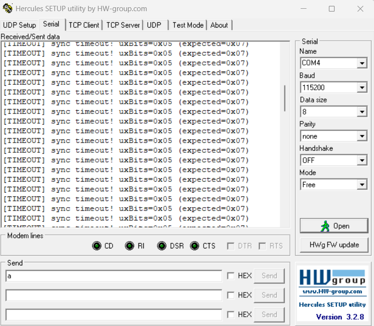

# Report — Week 2 / Ex4

`student_id`: 2510343    Commit của PREDICTION.md: 24b6b6e

## 1. Bảng so sánh RAM
| | Bytes thực tế | Cách tính |
|---|---|---|
| Event group (3 điểm đồng bộ) |24 | `log_mode0` SUMMARY: `struct=24 B` = `sizeof(StaticEventGroup_t)` (`EventBits_t` 4 B + `List_t` 20 B); `heap=32 B` = `free_before - free_after` quanh `xEventGroupCreate()` (24 B + phần đệm/header khối heap) |
| Event group (2 điểm) + notification (1 điểm) | 24 | `log_mode1` SUMMARY: `struct=24 B`, `heap=32 B` (vẫn 1 event group); notification: `heap=0 B` (`ntf_before - xPortGetFreeHeapSize()` quanh `xTaskNotifyGive`), `TCB_fields=5 B` (`ulNotifiedValue` 4 B + `ucNotifyState` 1 B) nằm sẵn trong TCB (`sizeof(StaticTask_t)=84 B`) → 24 + 0 = 24 |
| Chênh lệch | 0 | 24 − 24 = 0 B (heap: 32 − 32 = 0 B) |

## 2. Bảng so sánh tốc độ đánh thức
| Cách | Thời gian đánh thức (cycle) | Thời gian đánh thức (us) |
|---|---|---|
| Event-group-bit (producer_1 hoặc 2) | 1081 (`log_mode1`, n=16); 1084 (`log_mode0`, n=30) | 15.01 (`log_mode1`); 15.05 (`log_mode0`) |
| Task notification (producer_0) | 870 (`log_mode1`, n=30) | 12.08 |

Mô tả cách đo (2 điểm DWT: lúc gọi set/notify, lúc sync_task bắt đầu chạy):
- `t0`: đọc `DWT->CYCCNT` ngay trước `xTaskNotifyGive` (`t0_notify`, sau khi toggle `PA0`) hoặc trước `xEventGroupSetBits` (`t0_eg`, sau khi toggle `PA4`).
- `t1`: đọc `DWT->CYCCNT` ngay sau khi `ulTaskNotifyTake` (`t1_notify`) / `xEventGroupWaitBits` (`t1_eg`) trong `sync_task` (priority 3 > producer priority 2) trả về. `d = t1 − t0` (phép trừ unsigned), 72 cycle = 1 us.
- Chỉ ghi mẫu khi `t0` nằm sau lúc `sync_task` bắt đầu chờ (`(int32_t)(t0 − wait) > 0`), nên mẫu `d_eg=0` trong `log_mode1` (14/30 mẫu) là mẫu bị loại: producer_0 notify đến sau cùng, bit của producer_1/2 đã đủ từ trước nên `xEventGroupWaitBits` trả về ngay. Trung bình tính trên mẫu hợp lệ (`n=30` notify, `n=16` event group).
- Chênh lệch trong `log_mode1`: 1081 − 870 = 211 cycle (2.93 us) — notification nhanh hơn.

## 3. Khi nào KHÔNG dùng được notification
Tình huống bạn dự đoán ở PREDICTION.md, kiểm chứng lại: đúng hay sai, vì sao.

**Dự đoán:** phát sự kiện quảng bá (1-to-N), tức một nguồn kích hoạt nhiều task cùng lúc. **Kết luận: đúng.** Notification không có cơ chế 1-to-N. Muốn giả lập thì phải gọi N lần, phía phát phải giữ đủ N handle, và kết quả đo được ở dưới chậm hơn event group.
- `t0 = DWT->CYCCNT` ngay trước lệnh phát. `L_i = DWT->CYCCNT − t0`, đọc ngay khi listener i thoát khỏi lệnh chờ. `send_cost` = CYCCNT sau lệnh phát (hoặc sau vòng lặp phát) − `t0`.
- `BCAST_USE_NOTIFY=0`: gọi `xEventGroupSetBits(s_events, BCAST_BIT)` 1 lần. Listener chờ bằng `xEventGroupWaitBits(..., pdTRUE /*clear*/, pdFALSE, portMAX_DELAY)`.
- `BCAST_USE_NOTIFY=1`: gọi `xTaskNotifyGive(s_listener_h[i])` trong vòng lặp `i = 0..2`. Listener chờ bằng `ulTaskNotifyTake(pdTRUE, portMAX_DELAY)`.
- Mỗi cấu hình lấy 30 mẫu, và cả 30 mẫu đều giống hệt nhau (không có jitter vì không có task nào khác chạy). 72 cycle = 1 us.

| Cấu hình | `send_cost` (cycle / us) | L0 / L1 / L2 (cycle) | L0 / L1 / L2 (us) | Bước L(i) − L(i−1) | Số lần gọi API, handle cần biết |
|---|---|---|---|---|---|
| Event group, N=3 (`log_c3(eg).log`) | 5728 / 79.56 | 1776 / 3006 / 4236 | 24.67 / 41.75 / 58.83 | 1230 cyc (17.08 us) | 1 lần, 0 handle |
| Notification, N=3 (`log_c3(tn).log`) | 6002 / 83.36 | 912 / 2902 / 4892 | 12.67 / 40.31 / 67.94 | 1990 cyc (27.64 us) | 3 lần, 3 handle (`s_listener_h[]`) |
| Chênh lệch (notify − EG) | +274 (+3.81 us) | −864 / −104 / +656 | −12.00 / −1.44 / +9.11 | +760 cyc/listener | |
- Giải thích:
+ Một lần gọi, không cần biết người nghe. xEventGroupSetBits chỉ cần 1 lần gọi và 0 handle. Notification phải gọi N lần và giữ N handle (s_listener_h[]), nên thêm hoặc bớt listener là phải sửa code bên phát. Với event group, listener nào gọi WaitBits cũng nhận được, bên phát không đổi.
+Event group đánh thức cả 3 task sang Ready trong một lần gọi, nên mỗi listener sau chỉ tốn 1 lần chuyển ngữ cảnh (bước 1230 cycle). Notification phải quay về broadcaster để gọi API cho listener kế, tốn 2 lần chuyển ngữ cảnh cộng 1 lần gọi API (bước 1990 cycle, tức +760 cycle/listener). Kết quả: L2 nhanh hơn 656 cycle (4236 so với 4892), send_cost nhanh hơn 274 cycle (5728 so với 6002).
## 4. Timeout
Log/ảnh một lần `sync_task` bị timeout (cố tình làm 1 producer chậm hơn
`SYNC_TIMEOUT_MS`), và giá trị trả về của `xEventGroupWaitBits` lúc đó.

- **Log thực đo:** `[TIMEOUT] sync timeout! uxBits=0x05 (expected=0x07)` (khi làm `producer_1` chậm hơn `SYNC_TIMEOUT_MS = 50` ms).
- **Giá trị trả về của `xEventGroupWaitBits`:** `uxBits = 0x05` (`0b101` — chỉ có bit 0 của `producer_0` và bit 2 của `producer_2` đã được set, thiếu bit 1 của `producer_1`).
- **Cách phân biệt timeout với đủ bit:** Không kiểm tra `uxBits != 0` mà bắt buộc so khớp toàn bộ mặt nạ `(uxBits & ALL_BITS_MASK) == ALL_BITS_MASK` (`(0x05 & 0x07) == 0x05 != 0x07` → phát hiện timeout; đồng thời vì chưa đủ điều kiện nên `xClearOnExit = pdTRUE` không xóa các bit `0x05`).

## 5. Lệch so với dự đoán
Mỗi mục lệch + nguyên nhân vật lý.

- **RAM event group (câu 1)**: Dự đoán 24 B, thực đo `struct=24 B` → lệch 0 B. Tuy nhiên heap thực bị trừ 32 B → lệch +8 B (32 − 24) so với dự đoán nếu tính theo heap: `pvPortMalloc` cộng thêm phần header khối heap và làm tròn theo alignment, ngoài `sizeof(StaticEventGroup_t)`.
- **RAM notification (câu 2)**: Dự đoán 0 B, thực đo `heap=0 B` → lệch 0 B (`ulNotifiedValue`, `ucNotifyState` nằm sẵn trong TCB 84 B, không cấp phát thêm).
- **Tốc độ đánh thức (câu 3)**: Dự đoán notification nhanh hơn ; thực đo 870 cycle (12.08 us) so với 1081 cycle (15.01 us) → notification nhanh hơn 211 cycle (2.93 us), đúng chiều dự đoán. Nguyên nhân: `xTaskNotifyGive` chỉ thao tác trên TCB đã biết (đặt `ucNotifyState`, chuyển `sync_task` sang ready list rồi yêu cầu PendSV vì priority 3 > 2), còn `xEventGroupSetBits` phải duyệt `xTasksWaitingForBits`, kiểm tra bitmask rồi mới gỡ task khỏi danh sách chờ. Lưu ý: dự đoán ghi "critical section dài hơn", thực tế `xEventGroupSetBits` giữ bằng `vTaskSuspendAll()` trong lúc duyệt danh sách chứ không phải critical section.

## 6. Câu hỏi đánh đổi
Với `EVENT_BIT_COUNT` của **bạn**, nếu tăng thêm 1 bit (1 producer nữa) thì chu
kỳ đồng bộ trung bình đo được thay đổi thế nào? Trả lời bằng số từ dữ liệu của
bạn, rồi đo lại để kiểm chứng.

**(1) Dự đoán**  Dự đoán nằm trong khoảng từ 3.83 đến 5 ticks, gần 3.83. 
**(2) Số đo kiểm chứng** 
| | `EVENT_BIT_COUNT = 3` | `EVENT_BIT_COUNT = 4` | Lệch (4 − 3) |
|---|---|---|---|
| `Sync Period Avg` `log_mode0` (event group thuần) | 3.83 ticks (3833 us) | 3.86 ticks (3866 us) | +0.03 tick (+33 us) |
| `Sync Period Avg` `log_mode1` (producer_0 dùng notify) | 3.83 ticks (3833 us) | 3.86 ticks (3866 us) | +0.03 tick (+33 us) |
| Tổng `sync_tick` sau 30 lần đồng bộ | 115 | 116 | +1 tick |
| Wakeup event group (cycle) | 1084 (`mode0`), 1081 (`mode1`) | 1084 (`mode0`), 1081 (`mode1`) | 0 |
| Wakeup notification (cycle) | 870 | 870 | 0 |
| `free_heap` sau khi tạo task (B) | 3736 | 3120 | −616 |
- **Dự đoán đúng.** Thêm 1 bit chỉ làm chu kỳ đồng bộ tăng 33 us (3833 → 3866 us), nằm trong khoảng dự đoán 3.83..5 ticks. Cả `mode0` và `mode1` đều cho đúng cùng con số 3.86 ticks.

