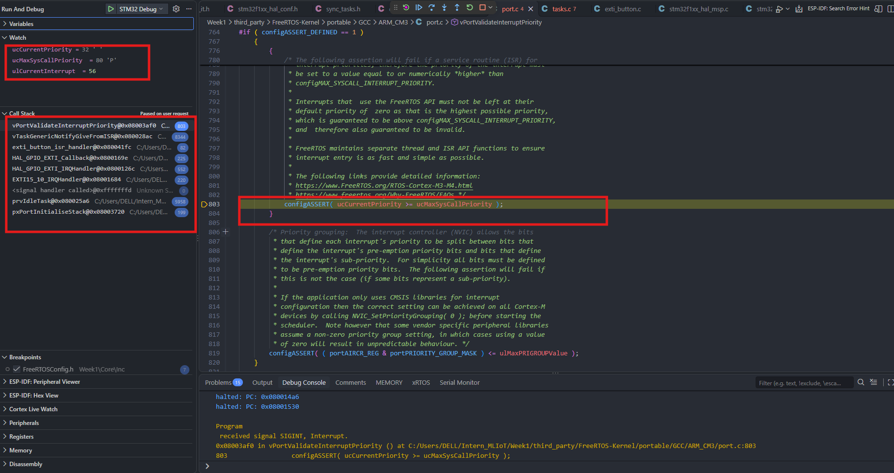
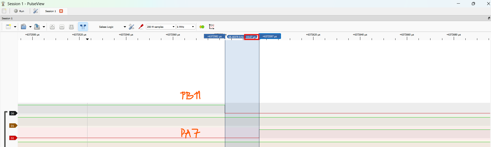
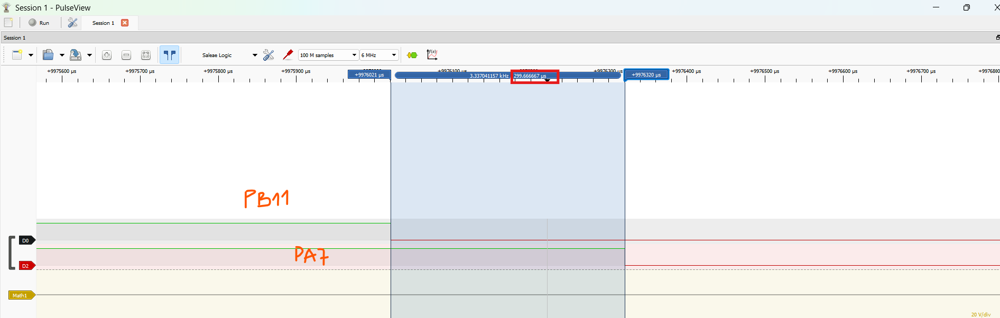
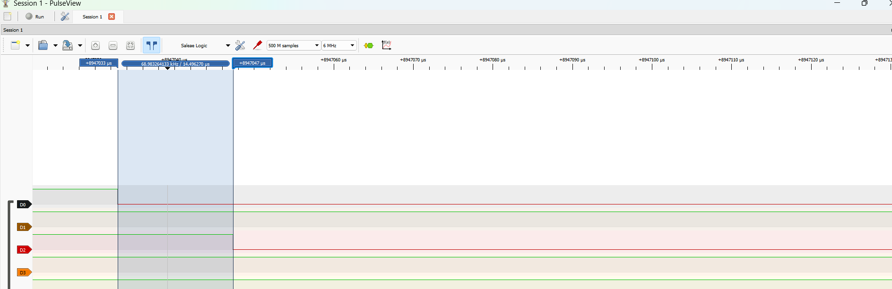
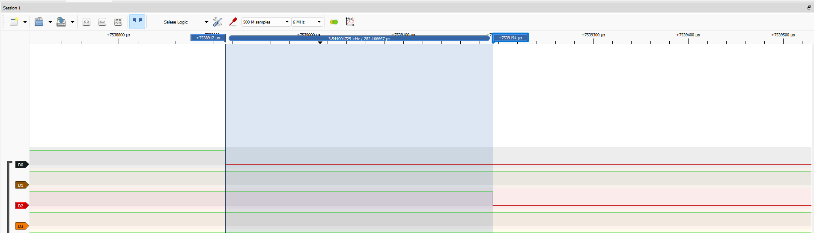

# Report — Week 3 / Ex1

`student_id`: 2510343    Commit của PREDICTION.md: 99ef53b

## 1. Bằng chứng configASSERT
Mô tả/log/ảnh lúc priority sai (bước 4 README) + giải thích chính xác **vì sao**
assert được kích hoạt (nêu đúng tên macro và điều kiện).

- **Mô tả trạng thái/log khi đặt priority sai (`HAL_NVIC_SetPriority(EXTI15_10_IRQn, 2, 0)`):**
  - Ngay khi nhấn nút `PB11` (`EXTI_PIN = 11`), ngắt phần cứng kích hoạt theo chuỗi Call Stack: `EXTI15_10_IRQHandler` → `HAL_GPIO_EXTI_IRQHandler` → `HAL_GPIO_EXTI_Callback` → `exti_button_isr_handler` (`exti_button.c:82`) → `vTaskGenericNotifyGiveFromISR` (`tasks.c:8344`) → `vPortValidateInterruptPriority` (`port.c:803`, `PC = 0x08003af0`).
  - Tại đây CPU bị khóa ngắt (`taskDISABLE_INTERRUPTS()`) và treo đứng trong vòng lặp vô hạn `for(;;)` của `configASSERT`, chân `PA7` (`ACK_PIN = 7`) không đảo trạng thái.
  - Giá trị các biến ghi nhận trực tiếp trên cửa sổ Watch: `ulCurrentInterrupt = 56` (`16` system exceptions + `EXTI15_10_IRQn = 40`), `ucCurrentPriority = 32` (`0x20`), `ucMaxSysCallPriority = 80` (`0x50`).
- **Giải thích nguyên nhân kích hoạt assert (tên macro & điều kiện):**
  - Khi gọi `vTaskNotifyGiveFromISR()`, hàm `vTaskGenericNotifyGiveFromISR()` gọi macro `portASSERT_IF_INTERRUPT_PRIORITY_INVALID()`, dẫn tới hàm `vPortValidateInterruptPriority()` thực thi câu lệnh kiểm tra tại `port.c:803`:
    `configASSERT( ucCurrentPriority >= ucMaxSysCallPriority );`
  - Phép so sánh `ucCurrentPriority >= ucMaxSysCallPriority` tức `32 >= 80` (`0x20 >= 0x50`) có kết quả **sai (`0`)** (do số priority NVIC nhỏ hơn nghĩa là ưu tiên phần cứng cao hơn ngưỡng `configMAX_SYSCALL_INTERRUPT_PRIORITY`), làm kích hoạt `configASSERT`.

## 2. Latency ISR → task
| Cấu hình | Dự đoán (us) | Đo được (us) | Đạt `LATENCY_BUDGET_US`? |
|---|---|---|---|
| Có `portYIELD_FROM_ISR` | 3.5 – 6.5 (< 15) | 14.67 | Có (14.67 us < 50 us) |
| Không có `portYIELD_FROM_ISR` | 0 – 1000 (trung bình 500) | 299.666667 (dao động 0 – 1000) | Không (299.666667 us > 50 us) |

Ảnh logic analyzer đính kèm cho cả 2 cấu hình.

- **Cấu hình 1 — Có `portYIELD_FROM_ISR(xHigherPriorityTaskWoken)` (`ISR_NVIC_PRIO = 6`):**
  - Trên PulseView (lấy mẫu `6 MHz`): sườn xuống kênh `D0` (`PB11`) tại `t0 = 6372582 us` kích hoạt `EXTI15_10_IRQHandler`, gọi `vTaskNotifyGiveFromISR` và `portYIELD_FROM_ISR` đặt cờ `PendSV` chuyển ngữ cảnh ngay khi thoát ISR sang `ack_task` để đảo kênh `D2` (`PA7`) tại `t1 = 6372597 us` (`Δt = 14.67 us`).

- **Cấu hình 2 — Không có `portYIELD_FROM_ISR(xHigherPriorityTaskWoken)` (`ISR_NVIC_PRIO = 6`):**
  - Trên PulseView (lấy mẫu `6 MHz`): sườn xuống kênh `D0` (`PB11`) tại `t0 = 9976021 us` chỉ đưa `ack_task` vào `Ready List` nhưng không kích hoạt `PendSV`, nên CPU quay lại `Idle Task` và phải chờ đến ngắt `SysTick` (`1000 Hz`, chu kỳ `1000 us`) kế tiếp mới chuyển ngữ cảnh sang `ack_task` đảo kênh `D2` (`PA7`) tại `t1 = 9976320 us` (`Δt = 299.666667 us`; thực tế phụ thuộc pha nhấn nút so với nhịp `SysTick` nên biến thiên trong khoảng `0 – 1000 us`).

## 3. Giải thích quan hệ priority
Giải thích bằng lời của bạn: số NVIC priority nhỏ/lớn nghĩa là gì, vì sao
`configLIBRARY_MAX_SYSCALL_INTERRUPT_PRIORITY` tồn tại, điều gì xảy ra nếu một
ISR ưu tiên cao hơn ngưỡng này gọi API FreeRTOS.

- **Ý nghĩa số NVIC priority nhỏ/lớn:** Trên ARM Cortex-M3 (`configPRIO_BITS = 4`, `NVIC_PRIORITYGROUP_4`), giá trị số của priority **càng nhỏ thì mức ưu tiên phần cứng càng cao** (`0` là ưu tiên cao nhất, `configLIBRARY_LOWEST_INTERRUPT_PRIORITY = 15` là thấp nhất). Khi lưu vào thanh ghi 8-bit `NVIC->IP`, giá trị này được dịch trái 4 bit (ví dụ mức `2` là `0x20`, mức `ISR_NVIC_PRIO = 6` là `0x60`).
- **Vì sao `configLIBRARY_MAX_SYSCALL_INTERRUPT_PRIORITY` tồn tại:** FreeRTOS bảo vệ các cấu trúc dữ liệu nội bộ của kernel (như `pxReadyTasksLists`, hàng đợi, danh sách sự kiện) trong vùng găng (critical section) bằng cách ghi giá trị `configMAX_SYSCALL_INTERRUPT_PRIORITY = 5 << 4 = 0x50` vào thanh ghi phần cứng `BASEPRI`. Cách này chỉ khóa các ngắt có số priority `>= 5` (`0x50 .. 0xF0`), đồng thời cho phép các ngắt thời gian thực cực kỳ khẩn cấp (priority `0 .. 4`, không gọi API FreeRTOS) vẫn được phép chạy xuyên qua critical section mà không bị kernel làm trễ.
- **Điều gì xảy ra nếu ISR ưu tiên cao hơn ngưỡng (`< 5`) gọi API FreeRTOS `...FromISR`:** Vì `BASEPRI = 0x50` không thể che được các ngắt có priority `< 5` (như mức `2` ở Bước 4), ISR đó có thể nhảy vào cắt ngang đúng lúc kernel hoặc một task khác đang sửa dở danh sách liên kết `xList` trong critical section, gây **hỏng cấu trúc dữ liệu kernel (race condition)** dẫn tới HardFault hoặc hành vi bất định (undefined behavior). Do đó, khi bật `configASSERT`, hàm `vPortValidateInterruptPriority()` sẽ chặn ngay lỗi này khi phát hiện `ucCurrentPriority < ucMaxSysCallPriority`.
## 4. Lệch so với dự đoán
Mỗi mục lệch + nguyên nhân vật lý (jitter NVIC, pipeline, v.v.).

- **Mục 1 — Kiểm tra khoảng hợp lệ `ISR_NVIC_PRIO = 6` và hành vi `configASSERT` ở mức priority `2`:**
  - **Con số lệch:** Dự đoán CPU dừng trong `for(;;)` của `configASSERT` do `0x20 < 0x50`, với `ucCurrentPriority = 32` (`0x20`) và `ucMaxSysCallPriority = 80` (`0x50`) → **Lệch `0` (khớp 100% dự đoán)**. Do `ISR_NVIC_PRIO = 6` , `configLIBRARY_MAX_SYSCALL_INTERRUPT_PRIORITY = 5` và `configLIBRARY_LOWEST_INTERRUPT_PRIORITY = 15`, ta có `5 <= 6 <= 15` (trên thanh ghi 8-bit sau khi dịch trái 4 bit: `0x50 <= 0x60 <= 0xF0`)
   nên ISR được phép gọi các API có ưu tiên thấp hơn hoặc bằng ngưỡng `...FromISR` một cách an toàn.
- **Mục 2 — Latency ISR → task khi có `portYIELD_FROM_ISR` (`ISR_NVIC_PRIO = 6`):**
  - **Con số lệch:** Dự đoán `3.5 – 6.5 us` (`250 – 450 cycles`, `< 15 us`), thực đo `14.67 us` (`~1056 cycles` ở `72 MHz`) → **Lệch `+8.17 us` đến `+11.17 us`** so với khoảng ước lượng số lệnh lý tưởng (nhưng vẫn `< 15 us` và đạt `LATENCY_BUDGET_US = 50 us`).
  - **Do:**
    - Firmware biên dịch ở mức tối ưu `-O0 -g3` (Debug) nên mọi hàm trong chuỗi (`EXTI15_10_IRQHandler` → `HAL_GPIO_EXTI_IRQHandler` → `HAL_GPIO_EXTI_Callback` → `exti_button_isr_handler` → `vTaskGenericNotifyGiveFromISR` → `PendSV_Handler` → `ulTaskNotifyTake` → `HAL_GPIO_TogglePin`) đều sinh mã prologue/epilogue đẩy/lấy biến cục bộ qua RAM stack thay vì giữ trên thanh ghi.
    - Bản build bật `configASSERT` và kiểm tra stack overflow (`taskCHECK_FOR_STACK_OVERFLOW` trong `vTaskSwitchContext()`), khiến riêng hàm `vPortValidateInterruptPriority()` và quá trình chuyển ngữ cảnh tốn thêm hàng trăm chu kỳ CPU..
- **Mục 3 — Latency ISR → task khi không có `portYIELD_FROM_ISR` (`ISR_NVIC_PRIO = 6`):**
  - **Con số lệch:** Dự đoán tăng thêm ngẫu nhiên từ `0 – 1000 us` (trung bình `500 us`), thực đo mẫu đại diện `299.666667 us` → **Nằm hoàn toàn trong dải dự đoán `0 – 1000 us`** (lệch `-200.333333 us` so với giá trị kỳ vọng trung bình `500 us`).
  - **Nguyên nhân vật lý / cơ chế kernel:** Thời điểm tay người nhấn nút `PB11` hoàn toàn bất đồng bộ (ngẫu nhiên) so với pha của bộ đếm phần cứng `SysTick` (`1000 Hz`, chu kỳ `1000 us`). Ở lần chụp `Q2_none.png`, sườn xuống `PB11` tại `t0 = 9976021 us` xảy ra trước ngắt `SysTick` kế tiếp khoảng `~285 us`; khi `SysTick_Handler` nổ mới kích hoạt `PendSV` để chuyển sang `ack_task` đảo `PA7` tại `t1 = 9976320 us`.

## 5. Câu hỏi đánh đổi
Nếu tăng `ISR_NVIC_PRIO` của bạn lên một bậc (ưu tiên thấp hơn) trong khi vẫn
hợp lệ, latency đo được thay đổi bao nhiêu? Trả lời bằng số đo thật, không
đoán.

- **Dự đoán từ dữ liệu gốc:** Tăng `ISR_NVIC_PRIO` lên 1 bậc từ `6` lên `7` (`0x70`) vẫn nằm trong khoảng hợp lệ (`5 <= 7 <= 15`). Vì trong bài chỉ có duy nhất ngắt `EXTI15_10_IRQn` hoạt động (không có ngắt mức `6` nào cạnh tranh làm trễ việc vào ISR), latency khi có `portYIELD_FROM_ISR` sẽ giữ nguyên quanh mức `14.67 us`.
- **Số đo kiểm chứng thực tế với `ISR_NVIC_PRIO + 1 = 7`:**
  - **Khi có `portYIELD_FROM_ISR`:** Sườn xuống `D0` (`PB11`) tại `t0 = 8947033 us` → cạnh đảo `D2` (`PA7`) tại `t1 = 8947047 us`, đo được **`14.496270 us`**. So với mức priority `6` (`14.67 us`), độ lệch là **`-0.173730 us`** (tương đương đúng `1` chu kỳ lấy mẫu `1/6 us = 0.166667 us` của Logic Analyzer ở `6 MHz`), chứng tỏ **latency thực tế không thay đổi**.

  - **Khi không có `portYIELD_FROM_ISR`:** Sườn xuống `D0` (`PB11`) tại `t0 = 7538912 us` → cạnh đảo `D2` (`PA7`) tại `t1 = 7539194 us`, đo được **`282.166667 us`** (vẫn biến thiên ngẫu nhiên trong khoảng `0 – 1000 us` chờ nhịp `SysTick` kế tiếp).

- **Kết luận:** Khi tăng `ISR_NVIC_PRIO` từ `6` lên `7` (có `portYIELD_FROM_ISR`), latency đo được là **`14.496270 us`** (chênh lệch `-0.173730 us` do độ phân giải lấy mẫu `6 MHz`), hoàn toàn **đạt `LATENCY_BUDGET_US = 50 us`** (`14.496270 us < 50 us`). Latency sẽ chỉ tăng thêm nếu tại đúng thời điểm nhấn nút có một ISR khác ở mức ưu tiên `6` đang chiếm giữ CPU.
