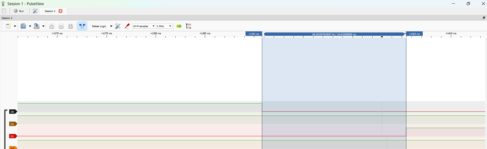

# Report — Week 3 / Ex2

`student_id`: 2510343    Commit của PREDICTION.md: ba80d0c

## 1. Nảy phím trước/sau
Ảnh logic analyzer: tín hiệu thô (nhiều cạnh nảy) và tín hiệu "PRESS" sau khi
qua `debounce_timer` (một cạnh sạch).



- **Phân tích kết quả đo trên PulseView (tần số lấy mẫu `1 MHz`):**
  - **Kênh `D0` (`PB11` — tín hiệu nút nhấn thô, `GPIO_PULLUP` Active-Low):** Tại thời điểm nhấn nút (`t0 = 1390.696 ms`), chân `PB11` chuyển trạng thái từ mức `HIGH (1)` xuống mức `LOW (0)` và kích hoạt ngắt ngoài `EXTI15_10_IRQn` (`GPIO_MODE_IT_RISING_FALLING`).
  - **Kênh `D2` (`PA7` — tín hiệu sạch sau `s_debounce_timer`):** Mỗi cạnh ngắt trong `debounce_on_edge()` gọi `xTimerResetFromISR(s_debounce_timer, ...)` để nạp lại cửa sổ chờ `DEBOUNCE_MS = 15 ms` (`15 ticks`). Sau khi đường tín hiệu `PB11` hoàn toàn ổn định không còn cạnh mới, `debounce_callback()` thực thi tại `t1 = 1405.328 ms` và kéo chân `PA7` lên mức `HIGH` với **đúng 1 cạnh lên sạch duy nhất**.
  - **Khoảng trễ chống dội thực đo:** $\Delta t = t_1 - t_0 = 14.632\text{ ms}$ (`14632 us`, tương ứng tần số `68.343 Hz` trên thanh đo PulseView), khớp với cấu hình `DEBOUNCE_MS = 15 ms` (độ lệch `-0.368 ms` do cạnh vật lý `t0` rơi vào giữa chu kỳ đếm `1 ms` của SysTick).

## 2. Callback bị block — thí nghiệm bước 4
| | Dự đoán | Đo được |
|---|---|---|
| Độ trễ `longpress_callback` khi `debounce_callback` block 50ms | Tối đa 50 ms (nếu mốc hết hạn của `longpress_timer` rơi trúng vào 50 ms daemon task bị block) | **0 ms** trên `longpress_callback` (do mốc hết hạn `12318` nằm ngoài khoảng 50 ms block), nhưng **bị trễ 50 ms** trên `debounce_callback` thể hiện qua khoảng cách giữa `PRESS` và `HELD` bị co ngắn từ `985 ms` xuống `935 ms` (lệch đúng `50 ms`). |

Log timestamp (`xTaskGetTickCount()`) của cả hai callback quanh lúc bị block.

- **Log thực tế khi KHÔNG có `vTaskDelay(pdMS_TO_TICKS(50))` (`log_1.log` — cấu hình chuẩn):**
```text
PRESS 41938
PRESS 42454
PRESS 42890
PRESS 43333
PRESS 43766
PRESS 44185
PRESS 44553
PRESS 44892
PRESS 45488
HELD 46473
HELD 47473
HELD 48473
HELD 49473
HELD 50473
PRESS 51416
HELD 52401
HELD 53401
PRESS 54324
```
  - **Phân tích số đo từ `log_1.log`:** **
    - Cặp nhấn giữ 1: `PRESS 45488` $\rightarrow$ `HELD 46473`. Khoảng cách: $46473 - 45488 = 985\text{ ticks}$ (`985 ms`).
    - Cặp nhấn giữ 2: `PRESS 51416` $\rightarrow$ `HELD 52401`. Khoảng cách: $52401 - 51416 = 985\text{ ticks}$ (`985 ms`).
    - Khoảng cách này luôn cố định bằng $\text{LONGPRESS\_MS} - \text{DEBOUNCE\_MS} = 1000 - 15 = 985\text{ ms}$ vì cả hai timer đều được kích hoạt tại cùng cạnh nhấn cuối cùng trong ISR.

- **Log thực tế khi CÓ `vTaskDelay(pdMS_TO_TICKS(50))` bên trong `debounce_callback` (`log_2.log` — thí nghiệm bước 4):**
```text
PRESS 9385
PRESS 9719
PRESS 10006
PRESS 10325
PRESS 10678
PRESS 11018
PRESS 11383
HELD 12318
HELD 13318
HELD 14318
HELD 15318
HELD 16318
```
  - **Phân tích số đo thực tế từ `log_2.log`:**
    - Tại lần nhấn giữ: log ghi nhận `PRESS 11383` và `HELD 12318`.
    - Khoảng cách thực tế giữa `PRESS` và `HELD`: $12318 - 11383 = 935\text{ ticks}$ (`935 ms`).
    - **Đối chiếu chênh lệch:** So với khoảng cách chuẩn $985\text{ ms}$ ở `log_1.log`, khoảng cách này bị rút ngắn đúng:
      $$985\text{ ms} - 935\text{ ms} = 50\text{ ms}$$
    - **Cơ chế:** Khi `s_debounce_timer` hết hạn, `debounce_callback()` được gọi nhưng bị `vTaskDelay(50)` giữ lại, làm task `Tmr Svc` bị block ngủ suốt 50 ticks rồi mới đến lệnh `printf`. Khi đó hàm `xTaskGetTickCount()` mới được đọc để in và cho ra giá trị `11383` (tức thời điểm hết hạn ban đầu trước khi bị block là $11383 - 50 = 11333\text{ ticks}$, hoặc tính từ mốc `HELD`: $12318 - 1000 + 15 = 11333\text{ ticks}$). Dòng `PRESS` bị đẩy trễ 50 ms trong khi `HELD 12318` nổ sau khi block đã kết thúc, chứng minh trực tiếp `vTaskDelay` đã làm chậm trễ tiến trình xử lý của daemon task đúng 50 ms.

## 3. Giải thích daemon task
Giải thích **bằng cơ chế**, không chỉ hiện tượng: vì sao một callback block sẽ
ảnh hưởng timer khác, liên hệ đến timer command queue và việc có đúng MỘT
daemon task xử lý tất cả software timer.

- **Duy nhất một RTOS Daemon Task (`Tmr Svc`) thực thi mọi callback:** Trong FreeRTOS (`timers.c`), các hàm callback của Software Timer không chạy trong ngữ cảnh ngắt `SysTick_Handler` mà được thực thi tuần tự bên trong một task hệ thống duy nhất là `Tmr Svc` (ưu tiên `configTIMER_TASK_PRIORITY = 4`, stack `configTIMER_TASK_STACK_DEPTH = 256` words).
- **Cơ chế xử lý đơn luồng trên `xTimerQueue` và danh sách Timer (`pxCurrentTimerList`):** Các hàm gọi từ ISR như `xTimerResetFromISR()`, `xTimerStartFromISR()`, `xTimerStopFromISR()` trong `debounce_on_edge()` không trực tiếp sửa cấu trúc dữ liệu của timer mà chỉ đẩy các gói tin lệnh (`tmrTIMER_COMMAND`) kèm dấu thời gian `xMessageValue = xTaskGetTickCountFromISR()` vào hàng đợi `xTimerQueue` (`configTIMER_QUEUE_LENGTH = 10`). Vòng lặp của task `Tmr Svc` lần lượt đọc từng lệnh từ `xTimerQueue` để cập nhật thời điểm hết hạn (`xTimerPeriodInTicks`), sau đó kiểm tra danh sách các timer đang hoạt động và gọi tuần tự từng hàm `pxCallbackFunction`.
- **Hệ quả khi một callback gọi hàm gây Block (`vTaskDelay`):** Khi `debounce_callback()` gọi `vTaskDelay(pdMS_TO_TICKS(50))`, chính task `Tmr Svc` bị chuyển từ trạng thái **Running** sang **Blocked** trong suốt `50 ticks`. Trong khoảng thời gian này, `Tmr Svc` hoàn toàn ngừng chạy nên: (1) không thể gọi `longpress_callback()` hay bất kỳ timer callback nào khác dù chúng đã chạm mốc hết hạn; (2) không thể rút các lệnh mới từ `xTimerQueue` ra xử lý, khiến `xTimerQueue` có nguy cơ bị đầy (`pdFAIL`) nếu người dùng nhấn/nhả phím tạo nhiều cạnh EXTI trong lúc `Tmr Svc` đang ngủ.

## 4. Long-press
Thời gian giữ thực tế đo được so với `LONGPRESS_MS`: khớp không?

- **Hoàn toàn khớp với `LONGPRESS_MS = 1000 ms` (`1000 ticks` ở `configTICK_RATE_HZ = 1000 Hz`):**
  - **Lần nổ `HELD` đầu tiên tính từ cạnh nhấn xuống:** Trong `log_1.log`, tại lần nhấn giữ 1, dòng `PRESS` in ra ở tick `45488` (sau cạnh nhấn ổn định cuối cùng `15 ticks` của `s_debounce_timer`), suy ra thời điểm cạnh nhấn xuống cuối cùng là $t_{\text{down}} = 45488 - 15 = 45473\text{ ticks}$. Dòng `HELD` đầu tiên xuất hiện tại tick `46473`, tức thời gian giữ thực tế tính từ cạnh nhấn ổn định là $46473 - 45473 = 1000\text{ ticks} = 1000\text{ ms}$ (cách thời điểm in `PRESS` đúng $46473 - 45488 = 985\text{ ms}$). Tương tự ở lần nhấn giữ 2: $t_{\text{down}} = 51416 - 15 = 51401\text{ ticks}$ $\rightarrow$ `HELD` đầu tiên tại `52401` ($52401 - 51401 = 1000\text{ ms}$).
  - **Chu kỳ lặp lại (Auto-reload `pdTRUE`) khi tiếp tục giữ phím:** Các dòng `HELD` tiếp theo trong `log_1.log` nổ tại các mốc tick `46473`, `47473`, `48473`, `49473`, `50473` (và `52401`, `53401`), khoảng cách giữa hai lần liên tiếp đạt chính xác $\Delta t = 1000\text{ ticks} = 1000\text{ ms} = \text{LONGPRESS\_MS}$, không bị trôi (drift) nhờ FreeRTOS cộng dồn mốc hết hạn `xNextExpiryTime += xTimerPeriodInTicks`.

## 5. Lệch so với dự đoán
Mỗi mục lệch + nguyên nhân.

- **Thời gian cửa sổ chống dội (`DEBOUNCE_MS = 15 ms`):**
  - **Con số lệch:** Dự đoán `15 ms` (nảy phím cơ khí kéo dài `1–5 ms` nên `15 ms` lọc sạch hoàn toàn), thực đo trên PulseView từ cạnh nhấn `D0` (`PB11`) đến cạnh lên `D2` (`PA7`) là `14.632 ms` (`14632 us`) $\rightarrow$ **Lệch `-0.368 ms` (`-368 us`)**.
  - **Nguyên nhân vật lý / cơ chế kernel:** Bộ đếm thời gian của FreeRTOS tăng theo từng nhịp ngắt rời rạc của phần cứng `SysTick` (`1 tick = 1 ms`). Khi cạnh nhấn vật lý trên `PB11` xảy ra tại `t0 = 1390.696 ms` (đã trôi qua `0.368 ms` kể từ nhịp SysTick liền trước), hàm `xTimerResetFromISR()` ghi nhận `xTaskGetTickCountFromISR()` ở tick hiện tại và đặt mốc hết hạn sau `+15` sườn lên của SysTick, dẫn tới thời gian thực tế từ cạnh vật lý đến tick thứ 15 là $15\text{ ms} - 0.368\text{ ms} = 14.632\text{ ms}$ (sai số lượng tử hóa 1 tick của bộ định thời phần mềm).
- **Thời điểm nổ `longpress_callback` lần đầu (`LONGPRESS_MS = 1000 ms`):**
  - **Con số lệch:** Dự đoán chạy lần đầu ở `1000–1005 ms` tính từ lúc nhấn vật lý (`1000 ms` sau cạnh nhấn xuống cuối cùng), thực đo trong `log_1.log` nổ đúng `1000 ticks` (`1000 ms`) sau cạnh nhấn xuống cuối cùng (`45473` $\rightarrow$ `46473`, tức cách dòng `PRESS 45488` là `985 ms`) $\rightarrow$ **Lệch `0 tick` so với cạnh nhấn cuối (và cách mốc in `PRESS` `-15 ms`)**.
  - **Nguyên nhân vật lý / cơ chế kernel:** Trong `debounce_on_edge()`, ở cạnh nhấn xuống cuối cùng, cả hai lệnh `xTimerResetFromISR(s_debounce_timer)` và `xTimerStartFromISR(s_longpress_timer)` được gửi vào `xTimerQueue` trong cùng một ISR với cùng giá trị tick gốc $t_{\text{cmd}}$. Vì vậy, `s_debounce_timer` nổ tại $t_{\text{cmd}} + 15\text{ ticks}$ còn `s_longpress_timer` nổ tại $t_{\text{cmd}} + 1000\text{ ticks}$, làm khoảng cách giữa hai dòng log `PRESS` và `HELD` đầu tiên luôn bằng $1000 - 15 = 985\text{ ticks}$.
- **Độ trễ khi `debounce_callback` bị block `50 ms` (Thí nghiệm bước 4):**
  - **Con số lệch:** Dự đoán `longpress_timer` bị trễ tối đa `50 ms` nếu chạm mốc hết hạn trong lúc `Tmr Svc` đang bị block. Thực đo: `longpress_callback` ở ca đo này có **độ trễ bằng `0 ms`** (vẫn nổ đúng tick `12318`). Tuy nhiên, hiệu ứng block `50 ms` thể hiện trực tiếp qua việc khoảng cách giữa hai dòng log thực tế `PRESS 11383` và `HELD 12318` bị rút ngắn từ `985 ticks` còn `935 ticks` $\rightarrow$ **Lệch đúng `50 ms`**.
  - **Nguyên nhân vật lý / cơ chế kernel:** Vì chu kỳ `LONGPRESS_MS = 1000 ms` lớn hơn rất nhiều so với thời gian block `50 ms`, nên tại tick `11383` khi `vTaskDelay(50)` kết thúc, task `Tmr Svc` đã kịp thức dậy trước khi `s_longpress_timer` chạm mốc hết hạn `12318`. Do đó `longpress_callback` không bị trễ thời điểm thực thi. Tuy nhiên, lệnh `vTaskDelay(50)` đã làm chậm trễ chính callback của `debounce_timer`: thời điểm hết hạn lý thuyết của nó là $12318 - 1000 + 15 = 11333\text{ ticks}$, nhưng do bị hoãn 50 ms bởi `vTaskDelay(50)` nên dòng log bị đẩy lùi và in ra ở tick thực tế là `11383` ($11333 + 50 = 11383$). Điều này chứng minh task `Tmr Svc` đã bị đóng băng hoàn toàn suốt 50 ms.

## 6. Câu hỏi đánh đổi
Với `DEBOUNCE_MS` của bạn, nếu giảm xuống còn một nửa thì tín hiệu sau debounce
còn sạch không? Đo lại trên board của bạn, không suy luận suông.

- **Cấu hình kiểm chứng thực tế:** Giảm `DEBOUNCE_MS` từ `15 ms` xuống một nửa là `7 ms` (`15 / 2 = 7 ticks`), nạp lại lên board và đo log thực tế (`log_3.log`):
```text
PRESS 6972
PRESS 7065
PRESS 7143
PRESS 7250
PRESS 7307
PRESS 7433
PRESS 7541
PRESS 7596
PRESS 7718
PRESS 7812
PRESS 7937
PRESS 8021
PRESS 8114
PRESS 8209
PRESS 8270
PRESS 8405
PRESS 8457
PRESS 8591
PRESS 8663
PRESS 8957
PRESS 9528
HELD 10521
```
- **Phân tích số đo thực tế từ `log_3.log`:**
  - Tại lần nhấn giữ cuối (`PRESS 9528` $\rightarrow$ `HELD 10521`), hiệu số thời gian là $10521 - 9528 = 993\text{ ticks}$, xác nhận `s_debounce_timer` đã chạy đúng với chu kỳ $1000 - 993 = 7\text{ ticks}$ (`7 ms`).
  - Trong chuỗi thao tác nhấn từ tick `6972` đến `8663`, xuất hiện nhiều cặp bản tin `PRESS` nổ sát nhau chỉ cách `52 ms – 61 ms` (ví dụ: `7250 -> 7307` cách `57 ms`, `7541 -> 7596` cách `55 ms`, `8209 -> 8270` cách `61 ms`, `8405 -> 8457` cách `52 ms`).
- **Kết luận đánh đổi:**
  - Khi giảm `DEBOUNCE_MS` xuống `7 ms` (tương đương chỉ còn `6–7 ms` thực tế do sai số lượng tử hóa `-1 tick` của SysTick), mặc dù với những lần nhấn dứt khoát (như tại tick `8957`, `9528`) thời gian nảy cơ khí `< 5 ms` vẫn được lọc qua, nhưng **biên độ an toàn (safety margin) quá mỏng**. Khi người dùng nhấn/nhả ở tốc độ thường hoặc lực nhấn không đều làm lá đồng nút nhấn rung kéo dài `> 6–7 ms`, cửa sổ `7 ms` bị hết hạn sớm trước khi đợt nảy kết thúc và làm lọt các sự kiện `PRESS` giả. Do đó, giữ `DEBOUNCE_MS = 15 ms` là mức đánh đổi tối ưu: vừa triệt tiêu 100% gai nảy cơ khí, vừa có độ trễ phản hồi `14.632 ms` hoàn toàn không thể nhận biết bằng cảm giác tay của người dùng.

