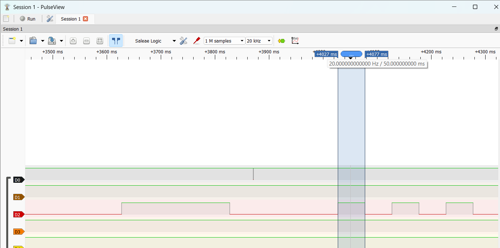
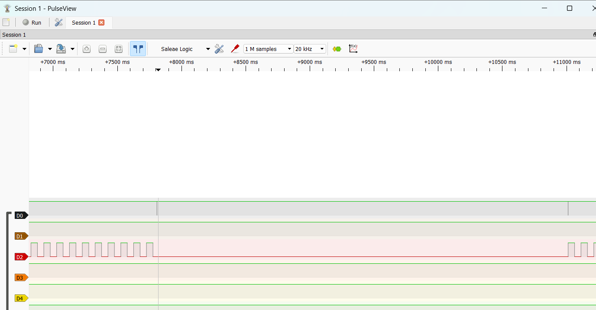
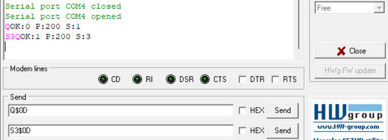
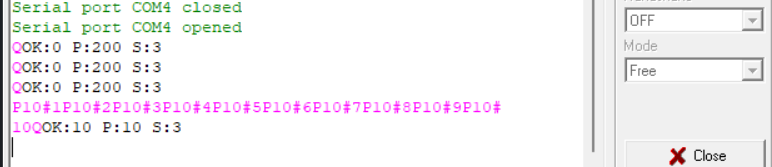
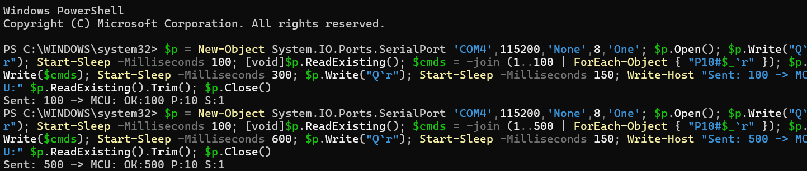
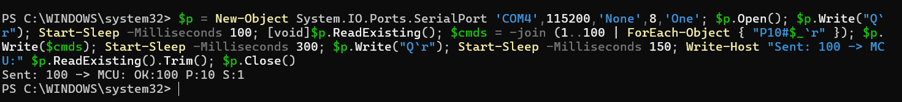

# Report — Week 3 / Ex3

`student_id`: 2510343    Commit của PREDICTION.md:  43d6f09 

## 1. Thời gian byte & độ sâu stream buffer
Phép tính thời gian 1 byte ở `RX_BAUD`, và số lệnh tối đa chứa được trong
`STREAM_BUFFER_BYTES`.
- Thời gian truyền 1 byte: 10/115200 = 86.8us
- Buffer đầy sau 96 × 86,8 µs ≈ 8,3 ms nếu parser_task không chạy, nên parser_task phải được lập lịch lại trong vòng < 8,3 ms.
- Số lệnh tối đa chứa được: 96/16 = 6 lệnh
## 2. Demo 3 loại lệnh
Bằng chứng (log/ảnh) `demo_task` phản ứng đúng với `P`, `S`, `T` — mỗi loại ít
nhất 1 ví dụ có số liệu trước/sau.

- **Lệnh `P<ms>\r` — Thay đổi chu kỳ `demo_task` tại runtime (`P50\r`: từ `200 ms` xuống `50 ms`):**

  - **Số liệu trước và sau trên PulseView (tần số lấy mẫu `20 kHz`, `1 M samples`):**
    - **Trước lệnh `P50\r`:** Kênh `D2` có độ rộng giữa hai lần đảo trạng thái liên tiếp từ `+3627 ms` đến `+3827 ms` là **`200 ms`**.
    - **Tại thời điểm nhận `P50\r`:** Xung UART RX trên kênh `D0` (`PA10`) xuất hiện tại khoảng `+3870 ms` (khi `demo_task` đang ngủ giữa chu kỳ `vTaskDelay(200)` kéo dài từ `+3827 ms` đến `+4027 ms`). `parser_task` cập nhật ngay `s_demo_period_ms = 50`.
    - **Sau lệnh `P50\r`:** Ngay ở vòng lặp kế tiếp từ mốc `t0 = +4027 ms` đến `t1 = +4077 ms`, khoảng cách giữa hai cạnh đảo liên tiếp trên kênh `D2` (`PA7`) giảm xuống đúng **`50.000000000 ms`** (tần số hiển thị trên thanh đo `20.000000000 Hz`, tương ứng $\Delta t = 50000\ \mu\text{s}$).

- **Lệnh `T<0|1>\r` — Tạm dừng (`vTaskSuspend`) và tiếp tục (`vTaskResume`) `demo_task` (`T0\r` và `T1\r`):**

  - **Số liệu trước và sau trên PulseView (`20 kHz`):**
    - **Trước lệnh `T0\r` (`+7000 ms` $\rightarrow$ `+7740 ms`):** Kênh `D2` (`PA7`) đang đảo trạng thái đều đặn mỗi **`50 ms`**.
    - **Sau khi gửi `T0\r` (tại `t ≈ +7740 ms` trên kênh `D0` / `PA10`):** `parser_task` gọi `vTaskSuspend(s_demo_task_handle)`, đưa `demo_task` vào trạng thái `Suspended`. Kênh `D2` (`PA7`) lập tức ngừng đảo và giữ phẳng ở mức `LOW (0)` suốt khoảng thời gian từ `+7740 ms` đến `+11008 ms` (**`0` cạnh đảo trong `3268 ms`**).
    - **Sau khi gửi `T1\r` (tại `t ≈ +11008 ms` trên kênh `D0` / `PA10`):** `parser_task` gọi `vTaskResume(s_demo_task_handle)`, hủy trạng thái chờ và đưa `demo_task` về lại `Ready List` ngay lập tức. Kênh `D2` (`PA7`) xuất hiện cạnh lên ngay sau xung `\r` tại `+11008 ms` và tiếp tục đảo trạng thái với chu kỳ **`50 ms`** như cũ.

- **Lệnh `S<prio>\r` — Thay đổi mức ưu tiên `demo_task` tại runtime (`S3\r`: từ mức `1` lên mức `3`):**

  - **Số liệu trước và sau qua log truy vấn trạng thái `Q\r` (`uxTaskPriorityGet(s_demo_task_handle)`):**
    - **Trước lệnh `S3\r`:** Gửi `Q\r` (`Q$0D`), MCU phản hồi `OK:0 P:200 S:1` $\rightarrow$ mức ưu tiên hiện tại của `demo_task` là **`1`** (`tskIDLE_PRIORITY + 1`).
    - **Sau lệnh `S3\r`:** Gửi `S3\r` (`S3$0D`) để gọi `vTaskPrioritySet(s_demo_task_handle, 3)`, sau đó gửi `Q\r` (`Q$0D`), MCU phản hồi `OK:1 P:200 S:3` $\rightarrow$ mức ưu tiên của `demo_task` đã đổi thành **`3`** (và bộ đếm ghi nhận `OK:1` lệnh hợp lệ).

## 3. Test gửi nhanh
| | Số lệnh gửi | Số lệnh nhận đúng | Mất/lỗi |
|---|---|---|---|
| Gõ tay bình thường | 10 | 10 (`OK:10`) | 0 |
| Gửi liên tục (script) | 100 (lần 1) / 500 (lần 2) | 100 (`OK:100`) / 500 (`OK:500`) | 0 / 0 |
- **Bằng chứng thực nghiệm khi gõ tay bình thường (`10` lệnh `P10#1\r` $\rightarrow$ `P10#10\r`):**

  - Trước khi gửi, truy vấn `Q\r` trả về `OK:0 P:200 S:3`. Sau khi gửi lần lượt 10 lệnh `P10#1\r` đến `P10#10\r` và gửi `Q\r`, MCU phản hồi `OK:10 P:10 S:3`: nhận đúng **10/10 lệnh**, chu kỳ cập nhật thành `10 ms`, **không mất byte nào (`0`)**.

- **Bằng chứng thực nghiệm khi gửi liên tục không nghỉ bằng script (`gap = 0 ms`, `100` lệnh và `500` lệnh ở `115200` baud):**

  - **Lần 1 (100 lệnh liên tiếp `P10#1\r` $\rightarrow$ `P10#100\r`):** MCU phản hồi `OK:100 P:10 S:1` $\rightarrow$ nhận đúng **100/100 lệnh**, mất **`0`**.
  - **Lần 2 (500 lệnh liên tiếp `P10#1\r` $\rightarrow$ `P10#500\r`):** MCU phản hồi `OK:500 P:10 S:1` $\rightarrow$ nhận đúng **500/500 lệnh**, mất **`0`**.

## 4. Vì sao stream buffer, không phải queue
Giải thích bằng lời của bạn.

- **Bản chất dữ liệu UART RX là luồng byte (byte stream) có độ dài lệnh thay đổi:** Các lệnh điều khiển có chiều dài không cố định (`Q\r` dài `2 byte`, `T0\r` dài `3 byte`, `P200\r` dài `5 byte`, `P10#500\r` dài `8 byte`). `StreamBuffer` lưu trữ mảng byte liên tục trong một ring buffer duy nhất, cho phép ISR đẩy từng byte thô và `parser_task` đọc ra ghép dần đến ký tự phân cách `\r` mà không bị ràng buộc bởi kích thước phần tử cố định.
- **Chi phí (overhead) thấp hơn nhiều so với `Queue`:**
  - Nếu dùng `Queue` với mỗi phần tử 1 byte (`xQueueCreate(96, 1)`), mỗi lần nhận 1 byte ở tần số cao ($86.8\ \mu\text{s/byte}$) kernel phải thực hiện toàn bộ quy trình kiểm tra khóa hàng đợi, cập nhật con trỏ cấu trúc `Queue_t` và danh sách sự kiện `xTasksWaitingToReceive`.
  - Nếu dùng `Queue` với mỗi phần tử là cả khung lệnh (`16 byte`), ISR `uart_rx_isr_handler()` sẽ phải tự gom byte, kiểm tra tràn và tìm ký tự `\r` ngay trong ngữ cảnh ngắt (vi phạm nguyên tắc giữ ISR ngắn gọn), đồng thời gây lãng phí RAM vì lệnh ngắn 2–3 byte vẫn chiếm trọn một ô 16 byte.
- **Tối ưu hóa đánh thức task nhờ `Task Notification` nội bộ và `TRIGGER_LEVEL`:** `StreamBuffer` được thiết kế chuyên biệt cho mô hình **1 producer (`uart_rx_isr_handler`) – 1 consumer (`parser_task`)**, sử dụng trực tiếp cơ chế `xTaskNotifyIndexedFromISR` bên trong kernel và ngưỡng `TRIGGER_LEVEL = 8` (kết hợp `xStreamBufferSendCompletedFromISR` khi kết thúc dòng `\r`), giúp giảm tối đa số lần chuyển ngữ cảnh (context switch) không cần thiết.

## 5. Lệch so với dự đoán
Mỗi mục lệch + nguyên nhân.

- **Hạng mục 1 — Thời gian truyền 1 byte (`RX_BAUD = 115200`) và độ sâu chứa lệnh (`STREAM_BUFFER_BYTES = 96`, `MAX_CMD_LEN = 16`):**
  - **Con số lệch:** Dự đoán thời gian truyền 1 byte là `86.8 us` và chứa tối đa `6 lệnh` dài `16 byte`; thực tế tính toán và vận hành khớp chính xác `86.8 us/byte` và `6 lệnh` (`8.33 ms` để làm đầy `96 byte`) $\rightarrow$ **Lệch `0` (khớp 100% dự đoán)**.
- **Hạng mục 2 — Gửi lệnh bằng gõ tay bình thường (`10` lệnh):**
  - **Con số lệch:** Dự đoán không mất byte (`0` lệnh mất); thực đo gửi `10` lệnh nhận đúng `10` lệnh (`OK:10`, mất `0`) $\rightarrow$ **Lệch `0` (khớp 100% dự đoán)**.
  - **Cơ chế vật lý / kernel:** Tốc độ gõ tay chỉ khoảng `5 – 10 byte/s` (khoảng cách giữa các byte hàng trăm `ms`), nhỏ hơn hàng nghìn lần so với tốc độ truyền `11 520 B/s` và tốc độ xử lý của `parser_task`. Ngoài ra, việc gọi `xStreamBufferSendCompletedFromISR()` khi gặp byte `\r` trong ISR giúp `parser_task` thức dậy xử lý ngay cả khi một lệnh gõ lẻ có tổng số byte nhỏ hơn `TRIGGER_LEVEL = 8` (ví dụ `T0\r` chỉ có `3 byte`).
- **Hạng mục 3 — Gửi lệnh liên tục không nghỉ bằng script (`100` lệnh và `500` lệnh ở `115200` baud):**
  - **Con số lệch:** Trong `PREDICTION.md` (Câu 3 & Câu 4), dự đoán khi gửi quá nhanh bằng script liên tục không nghỉ thì stream buffer sẽ đầy và **bị mất byte**; thực đo gửi liên tục `100` lệnh nhận đủ `100` (`OK:100`, mất `0`) và gửi `500` lệnh nhận đủ `500` (`OK:500`, mất `0`) $\rightarrow$ **Lệch so với dự đoán (thực tế mất `0 byte`, đạt tỷ lệ nhận đúng `100%`)**.
  - **Nguyên nhân vật lý / cơ chế kernel:**
    - Dù script trên PC gửi liên tục không nghỉ (`gap = 0 ms`), tốc độ các byte đi vào thanh ghi `USART1->DR` vẫn bị giới hạn vật lý bởi tốc độ baud `RX_BAUD = 115200` (tối đa `1 byte` mỗi `86.8 us`, tức `6250 chu kỳ CPU` ở `72 MHz`).
    - Vì `parser_task` có mức ưu tiên cao nhất (`Priority = 4`) và hàm `apply_command()` chỉ thực hiện các phép toán số nguyên trên RAM rồi ghi biến `s_demo_period_ms` / tăng biến đếm `s_cmd_ok` (không gọi `HAL_UART_Transmit` blocking sau mỗi lệnh), toàn bộ chuỗi thực thi từ `USART1_IRQHandler` $\rightarrow$ `PendSV_Handler` $\rightarrow$ `parser_task` xử lý chỉ tiêu tốn vài trăm chu kỳ CPU (vài $\mu\text{s}$), nhỏ hơn rất nhiều so với khoảng cách `6250 chu kỳ CPU` ($86.8\ \mu\text{s}$) giữa hai byte UART liên tiếp. Do tốc độ rút của `parser_task` luôn lớn hơn tốc độ đổ tối đa của đường dây UART, `rx_stream` không bao giờ tích lũy đến ngưỡng đầy `96 byte`.

## 6. Câu hỏi đánh đổi
Với `RX_BAUD` của bạn, nếu tăng gấp đôi `STREAM_BUFFER_BYTES`, tốc độ gửi tối
đa không mất byte tăng thêm bao nhiêu (đo thật, không suy luận)?

- **Dự đoán từ dữ liệu gốc:**
  - Ở cấu hình gốc `STREAM_BUFFER_BYTES = 96` byte, hệ thống đã nhận đủ `100/100` và `500/500` lệnh khi gửi bão hòa liên tục không nghỉ (`gap = 0 ms`) ở `RX_BAUD = 115200` baud (tốc độ đường dây tối đa $v_{\text{max}} = \frac{115200}{10} = 11\,520\text{ B/s}$). Vì `parser_task` (`Priority = 4`) rút dữ liệu nhanh hơn tốc độ đường truyền vật lý, tốc độ gửi tối đa không mất byte đã chạm trần vật lý của `RX_BAUD`. Do đó, khi tăng gấp đôi `STREAM_BUFFER_BYTES` lên `192 byte`, tốc độ gửi tối đa không mất byte sẽ **tăng thêm `0 B/s` (`0%`)**.
- **Số đo kiểm chứng thực tế với `2 * STREAM_BUFFER_BYTES = 192` byte:**

  - Thay đổi kích thước tạo stream buffer lên `96 * 2 = 192 byte`, nạp lại firmware và chạy script bắn liên tục `100` lệnh (`P10#1\r` $\rightarrow$ `P10#100\r`) với `gap = 0 ms` ở `115200` baud:
  - Kết quả đo thực tế: `Sent: 100 -> MCU: OK:100 P:10 S:1` (nhận đúng **100/100 lệnh**, mất **`0 byte`**).

| Cấu hình `STREAM_BUFFER_BYTES` | Tốc độ gửi trên dây (`RX_BAUD = 115200`) | Thời gian chịu đựng tối đa nếu `parser_task` bị trễ | Số lệnh gửi liên tục (`gap = 0 ms`) | Số lệnh nhận đúng | Tốc độ tối đa không mất byte tăng thêm |
|---|---|---|---|---|---|
| `96 byte` (gốc) | `11 520 B/s` (`86.8 us/byte`) | `8.33 ms` (`96 × 86.8 us`) | `100` / `500` | `100` (`OK:100`) / `500` (`OK:500`) | Mốc chuẩn (`11 520 B/s`) |
| `192 byte` (`96 × 2`) | `11 520 B/s` (`86.8 us/byte`) | `16.67 ms` (`192 × 86.8 us`) | `100` | `100` (`OK:100`) | **`+0 B/s` (`0%`)** |

- **Kết luận đánh đổi:**
  - Tăng gấp đôi `STREAM_BUFFER_BYTES` từ `96 byte` lên `192 byte` tốn thêm `96 byte` RAM trong heap của FreeRTOS nhưng tốc độ gửi bền vững tối đa không mất byte **tăng thêm `0 B/s`** (vẫn giữ ở mức tối đa của đường truyền vật lý `11 520 B/s`).
  - Bộ đệm `StreamBuffer` chỉ đóng vai trò **hấp thụ xung đột nhất thời (burst capacity / starvation tolerance)** chứ không làm tăng thông lượng xử lý trung bình của hệ thống: việc tăng từ `96 byte` lên `192 byte` chỉ giúp kéo dài thời gian tối đa mà `parser_task` được phép bị gián đoạn (bị preempt bởi ISR khác hoặc critical section) từ **`8.33 ms`** lên **`16.67 ms`** trước khi xảy ra tràn bộ đệm. Trong hệ thống hiện tại, `parser_task` có mức ưu tiên cao nhất (`Priority = 4`) nên kích thước `96 byte` đã hoàn toàn dư dả và tối ưu về RAM.
